# Laporan Praktikum 9 — Keranjang Session, Login Aman, dan Token CSRF

Nama : Faisal Mahmuda
NIM  : 25110026
Kelas: TK Grup D
Versi PHP: PHP 8.2.12 

## 1. Lingkungan
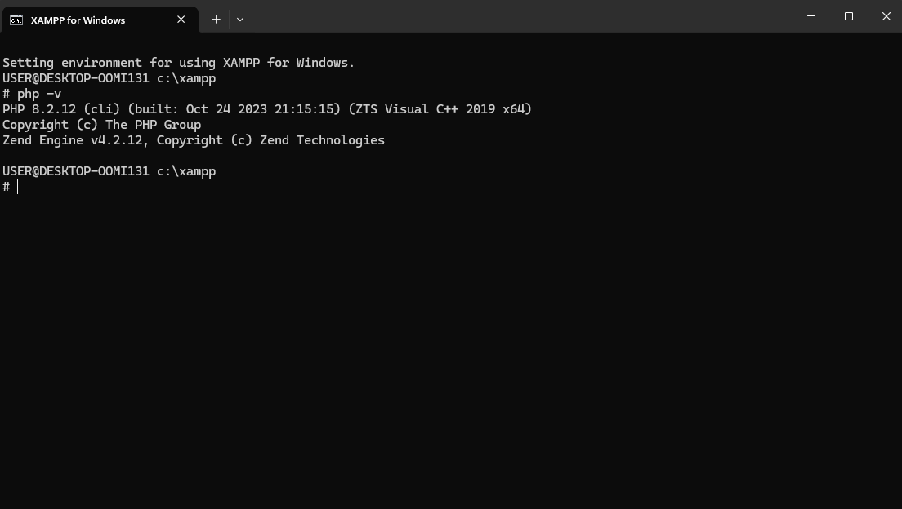

## 2. Keranjang berbasis session
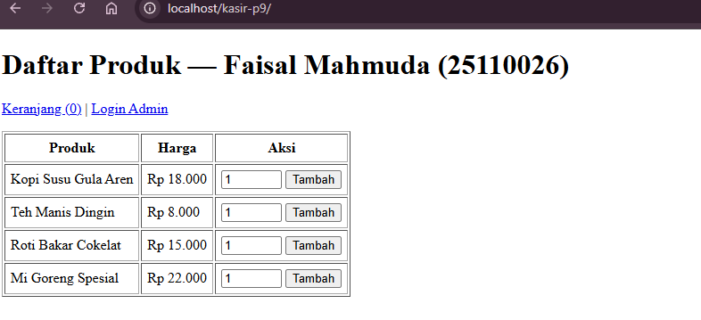
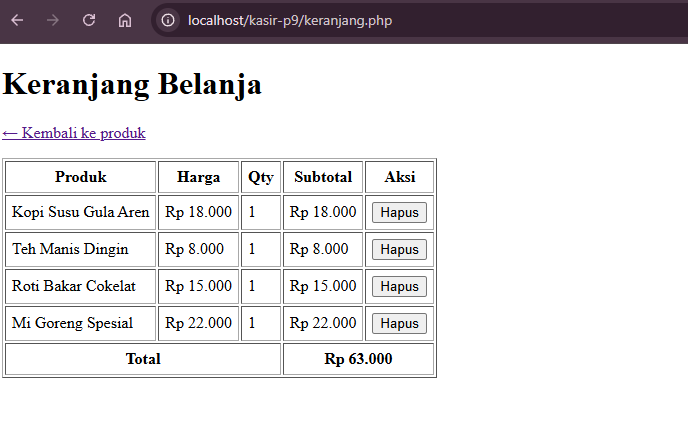
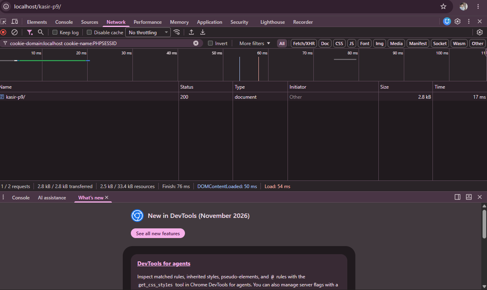

## 3. Login dengan password hash
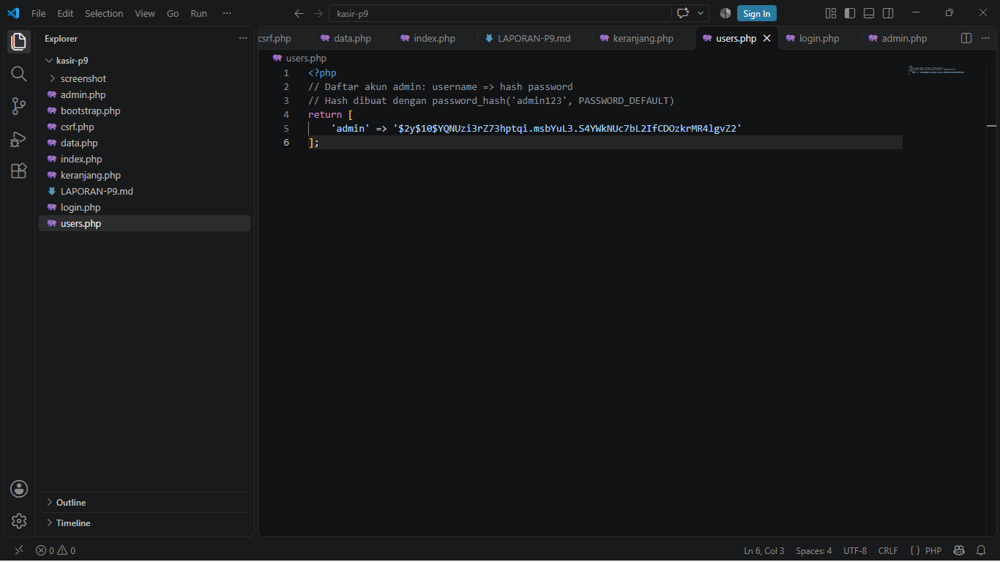
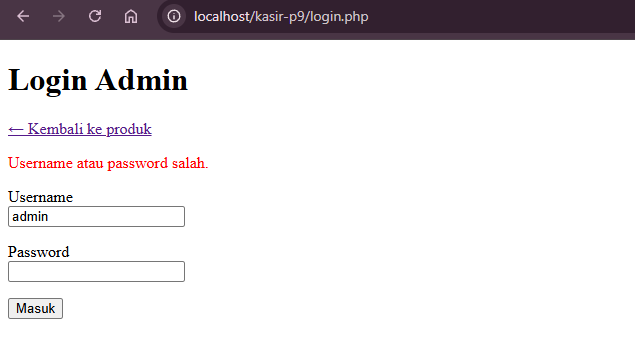
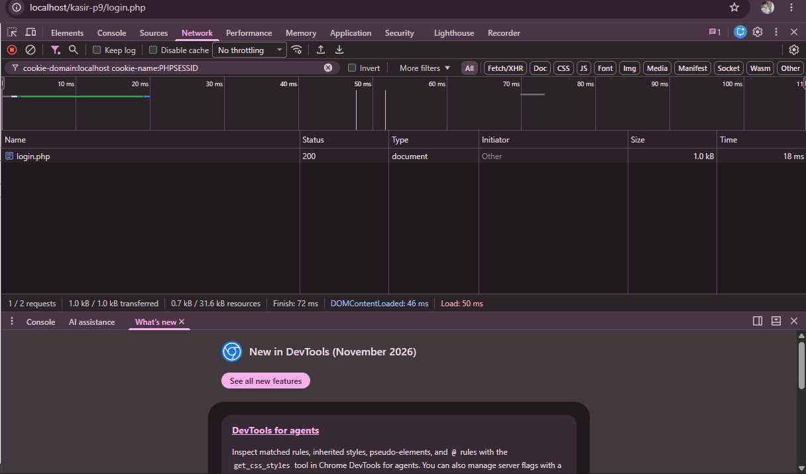
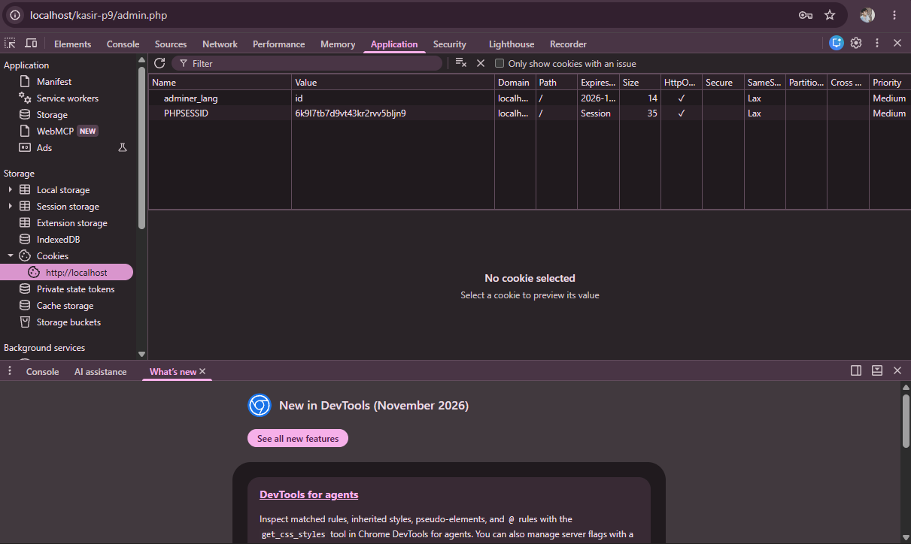

## 4. Token CSRF
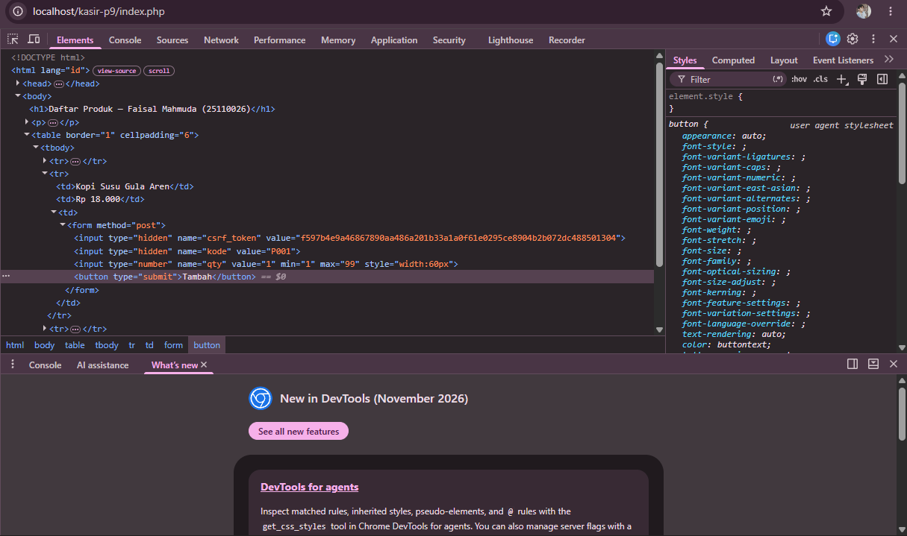
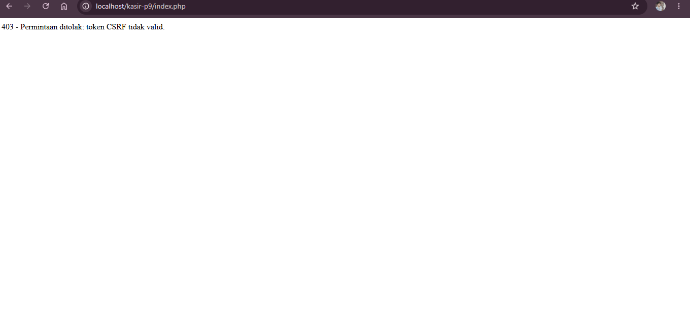
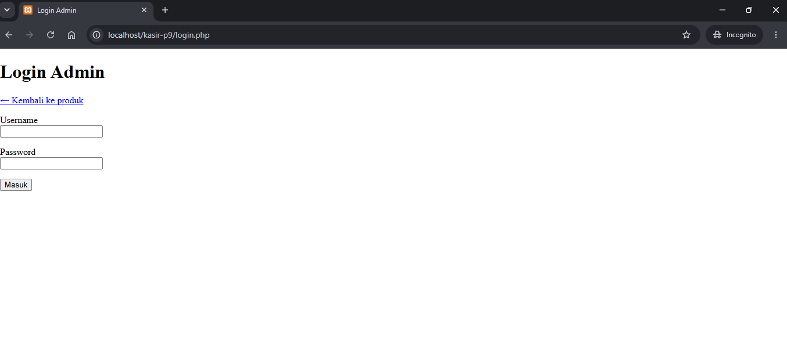

## 5. Hasil uji fungsional
| No | Uji | Hasil (Lulus/Gagal) |
|----|-----|---------------------|
| 1 | Keranjang bertahan | Lulus |
| 2 | Password tersimpan sebagai hash | Lulus |
| 3 | Regenerasi session | Lulus |
| 4 | Tolak request tanpa token | Lulus |
| 5 | Pesan login umum | Lulus |
| 6 | Halaman terproteksi | Lulus |

## 6. Pertanyaan
1. Mengapa isi keranjang tidak terlihat di cookie browser?
   Jawab: Karena yang disimpan di cookie browser itu bukan isi keranjangnya, tapi hanya kunci-nya saja, yaitu PHPSESSID.
2. Apa yang terjadi jika baris session_regenerate_id(true) dihapus?
   Jawab: Session ID tidak akan berubah setelah login. Nilai PHPSESSID sebelum login (di 07-sid-sebelum.png) akan sama persis dengan sesudah login (di 08-sid-sesudah.png)
3. Mengapa tombol Hapus dibuat dengan form POST, bukan link?
   Jawab: Karena Hapus itu mengubah data (menghapus item dari $_SESSION['keranjang']), dan sesuai aturan, semua aksi yang mengubah data harus pakai POST, bukan GET / link